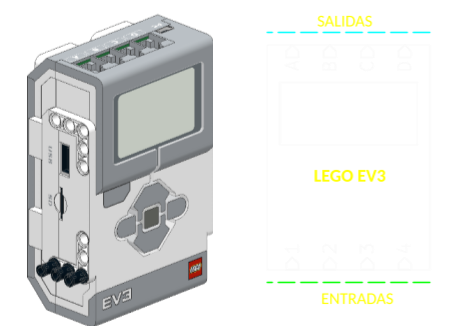

# EV3LAB1 pablinza@me.com
Programación del modulo Lego Mindstorm EV3 con lenguaje __micropython__ [--> Sitio Oficial](https://education.lego.com/es-es/product-resources/mindstorms-ev3/teacher-resources/python-for-ev3/) <br />
Lego Mindstorm es un kit completo que en su tercera generación EV3 fue distribuida en dos Ediciones: el set __HOME (31313)__ y el set __EDUCATION (45544)__ en ambos el cerebro principal __Brick EV3__ esta basado en un Microprocesador TI AM1808 arquitectura ARMv9. Por defecto el modulo EV3 corre una versión especial de linux que permite la programación gráfica por bloques (EV3 Classroom) utilizando una capa intermedia basada en Python. El modulo cuenta con conectividad USB, Bluetooth y 8 puertos E/S para los diferentes sensores que se incluyen en el kit. <br />
<br />
Este repositorio contiene código de los programas desarrollados con __EV3 Python__(Pybrick) para cada maquina o robot construido en el laboratorio. Comentar que se describen ejemplos básicos enfocados al aprendizaje en la etapa escolar como complemento a la programación en bloques realizados con __EV3 Classroom__. <br />
El IDE utilizado para la programación es __Visual Code__ disponible de forma gratuita en su sitio oficial [ --> Click](https://code.visualstudio.com/) <br />
Las instrucciones para descargar e instalar el interprete micropython en __EV3 Python__ están en el siguiente enlace [ --> Click](https://education.lego.com/es-es/product-resources/mindstorms-ev3/teacher-resources/python-for-ev3/) <br />

En resumen, una vez descargado el firmware, debes descomprimir y copiar el archivo de imagen a una tarjeta microSD de al menos 4GB de capacidad, para este paso yo utilice la aplicación __ISO Image Writter__, lo bueno de todo esto es que no modificaras el firmware por defecto que tiene tu modulo EV3 (EV3 Classroom) ya que el interprete Python correrá solo cuando insertas la tarjeta SD. Para empezar la programación solo necesitaremos conectar el modulo a la PC con un cable USB. <br />

## Configuración del Modulo EV3 con Python
En el siguiente enlace [--> Click](https://youtu.be/wHSbDzvcbXE) dejo un vídeo que muestra la preparación del __EV3 Python__ para su programación con el IDE __Visual Code__, la creación de un programa inicial y prueba de sensores-actuadores.
<p align="center">
  </img>
</p> <br />

Todos los puertos de entrada y salida tienen capacidades y una configuracion similar, por lo que un sensor o actuador puede conectarse a cualquiera de los cuatro puertos siempre que corresponda un sensor como entrada (1,2,3,4) y actuador como salida (A,B,C,D). Incluso los puertos de salida contienen lineas de realimentación para el control de lazo cerrado en los motores. Aquí dejo una descripción de los pines que resume la funcionalidad:
<br />
<div align="center"> 
  
| <sub>PIN RJ-12</sub>| <sub>PUERTO DE ENTRADA</sub> | <sub>PUERTO DE SALIDA</sub> |
|----------|:-------------:|------:|
| 1 | <sub>12-bit ADC(0-5V)/TC</sub> | <sub>PWM+ (+9V/0.7A)</sub> |
| 2 | <sub>GND</sub> | <sub>PWM-(+9V/0.7A)</sub> |
| 3 | <sub>GND</sub> | <sub>GND</sub> |
| 4 | <sub>+5V / 0.2A</sub> | <sub>+5V / 0.2A)</sub> |
| 5 | <sub>SCL/IN1 (3.3V)</sub> | <sub>ENCA(5V)</sub> |
| 6 | <sub>SCK/IN2 (3.3V)</sub> | <sub>ENCB (5V)</sub> |
</div>
<br />
A continuación se observa un programa simple que permite mover un servomotor en presencia de un objeto cercano al sensor IR
<br />

```python
from pybricks.hubs import EV3Brick
from pybricks.ev3devices import Motor, InfraredSensor
from pybricks.parameters import Port, Direction
from pybricks.tools import wait
ev3 = EV3Brick() # Inicializar el Brick
motor = Motor(Port.A) # Configurar el motor en el puerto A
sensor_ir = InfraredSensor(Port.4) # Configurar el sensor infrarrojo en el puerto 4
ev3.speaker.beep()
print("Sistema listo. Esperando objeto...")
while True:
    distancia = sensor_ir.distance() # Leer la proximidad del objeto
    if distancia > 0 and distancia < 30: # # Comprobar si hay un objeto dentro del umbral (0-100)
        ev3.speaker.say("Objeto detectado")
        motor.run_angle(200, 360) # Girar el motor 360 grados a una velocidad moderada (200 grados/segundo)
        wait(500) # Pausa breve para evitar activaciones repetidas inmediatas
    else:
        motor.stop() # Mantener el motor detenido si no hay objetos cerca
    wait(50) # Pequeña pausa para no saturar el procesador del EV3
```

<br />
Autor: Pablo Zarate, puedes contactarme a pablinza@me.com / pablinzte@gmail.com.  <br />
Visita mi Blog  [Blog de Contenidos](https://pablinza.blogspot.com/). <br />
Visita mi Canal [Mi canal Youtube](http://www.youtube.com/@pablozarate7524). <br />
Santa Cruz - Bolivia 
<br clear="left"/>
